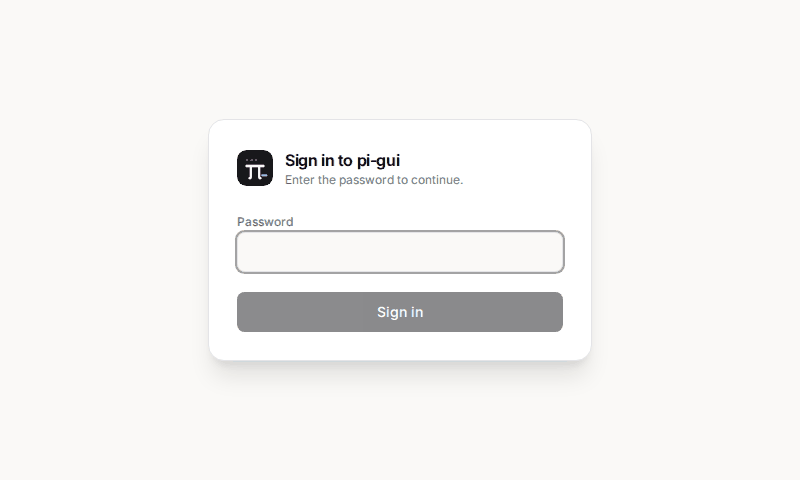
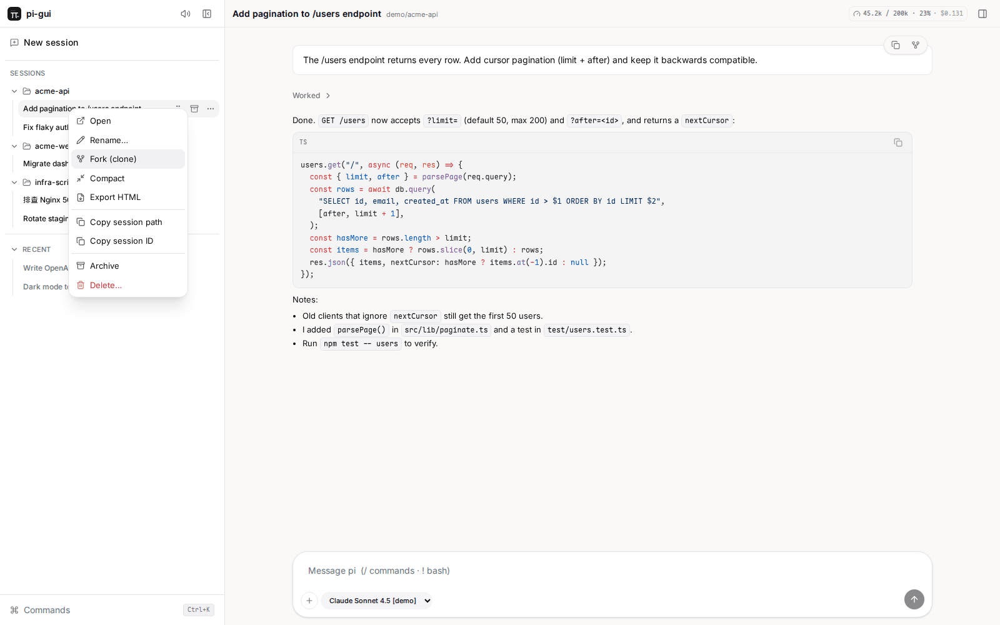
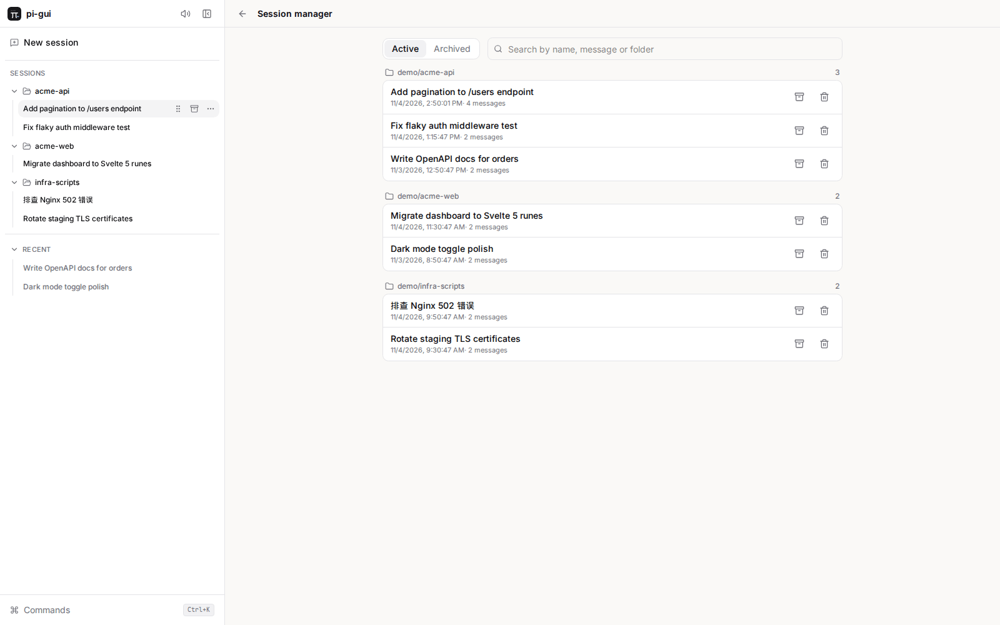
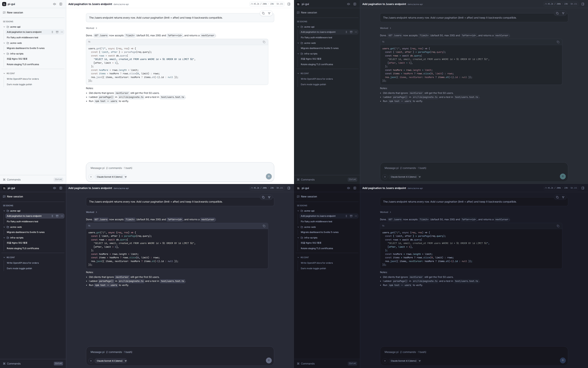
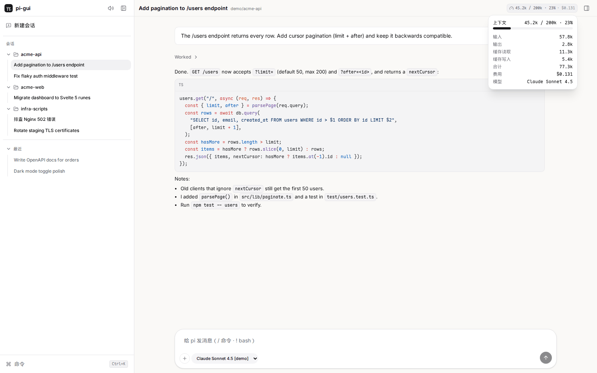
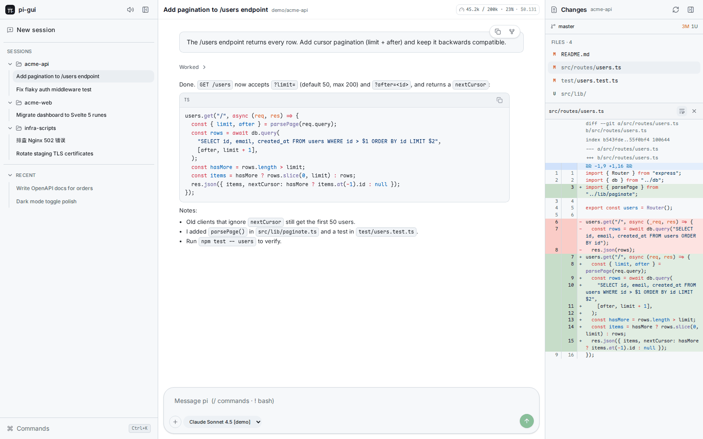

# pi-gui

A web UI for [pi](https://www.npmjs.com/package/@earendil-works/pi-coding-agent): multi-session chat, a standalone daemon with password login, 8 themes, English / 简体中文, detailed token usage and a session manager. [简体中文](#简体中文)

> **Fork notice.** This is a fork of [ankitchouhan1020/pi-gui-extension](https://github.com/ankitchouhan1020/pi-gui-extension) (MIT). The chat UI, hub and `/gui` command are the original author's work; everything listed under *What's new* was added in this fork.


## What's new in this fork

### Standalone daemon + password login

`bin/pi-gui` runs the server on its own, without a terminal pi session, so you can leave it running (for example under systemd) and open it from a browser whenever you like. Set `PI_GUI_PASSWORD` to require a login; the session is kept in an HttpOnly cookie.



### Detailed context and token usage

The header shows `used / window · percent · cost`. Hover or click it for input, output, cache read/write, total tokens, cost and the model name.

### Session manager and right-click menu

Browse every stored session grouped by folder, search, and switch between *Active* and *Archived*. Right-click a session in the sidebar (or use the `⋯` button, which is always visible on touch screens) for open, rename, fork (clone), compact, export HTML, copy path / ID, archive / restore and delete. Items that don't apply are hidden or disabled, for example compact while a turn is running. Delete asks for confirmation.

| Context menu | Session manager |
|---|---|
|  |  |

Archived sessions are moved to `~/.pi/agent/sessions-archive` and can be restored at any time.

### 8 themes

Light and Dark, plus ports of GitHub Light, Atom One Light, Solarized Light, One Dark Pro, Dracula and Tokyo Night. Palettes come from the official VS Code themes, and code blocks and diffs use the matching syntax colours. Pick one under *Commands → Appearance & language* (`Ctrl/⌘ + K`).



### English and 简体中文

The language follows your browser by default and can be switched in the same settings dialog. The choice is remembered per browser.



### Git panel fixes

The Changes panel no longer freezes the tab on large diffs (size and highlight caps), uses a 5 s git timeout, collapses untracked directories, shows correct paths when the session folder is inside a repo, and explains clearly when a folder isn't a git repo.



### Smaller changes

- The Quit command was removed from the UI.
- Settings, session manager and log out live in the command menu (`Ctrl/⌘ + K`).

## Install

Requires Node.js ≥ 20 and a working pi install (models and auth already set up).

```bash
git clone https://github.com/BBDXF/pi-gui-extension.git
cd pi-gui-extension
npm install                      # runtime deps
```

The built UI in `dist/` is committed. To change the UI, run `npm install --prefix web && npm run build`.

### As a pi extension (`/gui`)

```bash
pi install /path/to/pi-gui-extension
```

Then, inside any pi session:

```text
/gui                          # live-attach the current session and open the browser
/gui <sessionId>              # open that session
/gui open <sessionId> 4000    # custom port
/gui stop                     # shut down
```

This mode listens on loopback only and has no password, like the terminal UI on your machine.

### As a standalone daemon

```bash
npm install -g .                 # provides the `pi-gui` command
# or run it straight from the clone:
PI_GUI_PASSWORD=change-me node bin/pi-gui
```

Then open <http://127.0.0.1:3847>.

#### Start at boot with systemd (user unit)

```bash
mkdir -p ~/.config/pi-gui ~/.config/systemd/user
cat > ~/.config/pi-gui/env <<'EOF'
PI_GUI_PORT=3847
PI_GUI_HOST=127.0.0.1
PI_GUI_PASSWORD=change-me
EOF
chmod 600 ~/.config/pi-gui/env

cp contrib/pi-gui.service ~/.config/systemd/user/
systemctl --user daemon-reload
systemctl --user enable --now pi-gui
loginctl enable-linger "$USER"   # keep running after you log out
journalctl --user -u pi-gui -f   # logs
```

If `pi-gui` is not on systemd's `PATH`, edit `ExecStart` in the unit to the full path of `bin/pi-gui`.

## Configuration

| Variable | Default | Meaning |
|---|---|---|
| `PI_GUI_PORT` | `3847` | HTTP port |
| `PI_GUI_HOST` | `127.0.0.1` | Bind address |
| `PI_GUI_PASSWORD` | *(unset)* | Enables login. When set, every `/api/*` call returns 401 until you sign in |
| `PI_GUI_SESSION_IDLE_MS` | `86400000` (1 day) | Close a live session when no browser is attached (`0` disables) |
| `PI_GUI_SESSIONS_DIR` | `~/.pi/agent/sessions` | Where stored sessions are read from |
| `PI_GUI_ARCHIVE_DIR` | `~/.pi/agent/sessions-archive` | Where archived sessions are moved |

Models, auth, skills and extensions come from pi itself. Set `PI_CODING_AGENT_DIR` to point pi at a different config directory.

## Security

- The server binds to `127.0.0.1` by default. Keep it that way unless you need remote access.
- If you bind another address, **always set `PI_GUI_PASSWORD`**. The UI can run commands and edit files through the agent, so an open port is remote code execution on your machine.
- The password protects the app only; traffic is not encrypted. Do not expose it directly to the internet. Put it behind a reverse proxy with TLS (and ideally a VPN or SSH tunnel), for example `ssh -L 3847:127.0.0.1:3847 your-server`.
- Logins are in-memory: restarting the daemon signs everyone out.

## Original features

Multi-session chat with streaming, steering and abort, model and thinking-level pickers, a command palette, a skill workspace, image paste and `!bash` in the composer. See the upstream project for details on these.

## Development

```bash
npm install && npm install --prefix web
npm run dev:server   # :3847
npm run dev:web      # :5173, proxies /api
npm run check && npm run build
npm test
```

Coding agents: read [`llms.txt`](./llms.txt) first.

## License

[MIT](./LICENSE). Copyright (c) 2026 BBDXF; original work copyright (c) 2026 Ankit Chouhan.

---

## 简体中文

pi-gui 是 [pi](https://www.npmjs.com/package/@earendil-works/pi-coding-agent) 的网页界面，本仓库 fork 自 [ankitchouhan1020/pi-gui-extension](https://github.com/ankitchouhan1020/pi-gui-extension)（MIT）。

**本 fork 新增：**

- **独立守护进程**：`bin/pi-gui` 无需终端里的 pi 即可运行，可配合 systemd 开机自启（见上文）。
- **密码登录**：设置 `PI_GUI_PASSWORD` 后需要登录（HttpOnly Cookie）。
- **中英文界面**：默认跟随浏览器语言，可在 *命令 → Appearance & language*（`Ctrl/⌘ + K`）中切换。
- **8 套主题**：浅色、深色，以及 GitHub Light、Atom One Light、Solarized Light、One Dark Pro、Dracula、Tokyo Night（移植自 VS Code 官方主题）。
- **详细的上下文 / Token 用量**：已用 / 窗口、输入、输出、缓存读写、合计、费用和模型。
- **会话管理与右键菜单**：归档 / 恢复 / 删除、压缩、分叉、重命名、导出 HTML、复制路径或 ID。
- **Git 面板修复**：大 diff 不再卡死标签页，git 超时 5 秒，路径与非仓库提示更准确。

**安装：**

```bash
git clone https://github.com/BBDXF/pi-gui-extension.git && cd pi-gui-extension && npm install
pi install /path/to/pi-gui-extension          # 在 pi 中使用 /gui
PI_GUI_PASSWORD=你的密码 node bin/pi-gui        # 或作为独立服务运行，访问 http://127.0.0.1:3847
```

**安全提示：** 默认只监听 `127.0.0.1`。如需对外访问，必须设置 `PI_GUI_PASSWORD`，并放在带 TLS 的反向代理或 SSH 隧道之后；不要把端口直接暴露到公网，因为该界面可通过智能体执行命令、修改文件。
